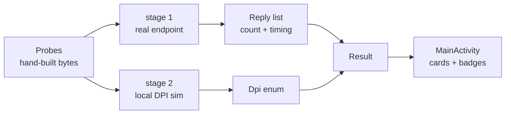

# CircumVolve Probe

**English** · [简体中文](README.zh-CN.md) · [繁體中文](README.zh-TW.md)

An Android probe that reproduces the DNS-poisoning and SNI-blocking evasion
strategies found by *CircumVolve: Automated Discovery of Censorship Evasion
Strategies Using Large Language Models* (CCS 2026).

No proxy, no VPN, no root: every datagram is built by the app itself and sent
straight from the process. The UI is dark-only and localized in English,
Simplified Chinese and Traditional Chinese.

- Paper: <https://gfw.report/publications/ccs26/en/>
- Source of the original system: <https://github.com/alizohaib/ccs26-circumvolve>
- Project page (Chinese): <https://gfw.report/publications/ccs26/zh/>

> This is a measurement instrument for research and for reproducing published
> results. It does not tunnel traffic and it is not a circumvention client.

## Answer: yes, both are bypassable — narrowly

Measured on China Telecom Wi-Fi, no proxy, no VPN, no root, system DNS untouched.

| Block | Works without a proxy? | Evidence |
|---|---|---|
| DNS poisoning | **Yes, per query** | *decoy second question*: 0/3 runs injected in three separate runs, genuine answer every time (`+120 ms`, real IPs) |
| SNI blocking | **Yes, per connection** | *trailing dot FQDN*: baseline `signal.org` reset, control `www.cloudflare.com` handshakes, `signal.org.` handshakes |

Both are real: the control group proves the block existed, and the variant proves it
was evaded on that connection.

But the scope is narrow, and it matters:

- **It is packet-level, not a tunnel.** A bypassed query answers one name once; a
  bypassed handshake completes one TCP connection. Neither gives you a working
  channel to a blocked site. This app is a measuring instrument, not a proxy
  replacement.
- **DNS bypass only helps code that builds its own queries.** Anything using the
  system resolver still receives the forgery, because the injection happens on the
  path to `:53`, not inside the app.
- **Only one variant worked per block.** Four of the seven DNS cases were injected
  on every run; of the TLS attempts the trailing dot was the only one to handshake
  — record splitting lost all three variants on this network, which means the
  middlebox reassembles TLS records.
- **Results move between runs.** The same datagram drew two forged replies in one
  run and none in the next, which is why every case is sent three times and the
  report leads with a rate.

So: **the GFW's DNS injector and its SNI matcher can each be defeated on
individual packets without any proxy, but that is not the same as having working
access to blocked sites.** Treat the result as "this specific rule was evaded
here", not as "the blockade is broken".

## Why these targets

Two different blocks need two different targets, and picking the wrong one makes
the TLS section useless.

**DNS — `pornhub.com`.** Only the name matters here: the query is a UDP datagram
to `8.8.8.8:53` and the answer never depends on the site being reachable. Any name
on the GFW keyword list works, and this one draws forged replies on every run.

**TLS — `signal.org`.** `DIG` returns `104.18.10.47` / `104.18.11.47`, both
Cloudflare, so the address is shared with unrelated sites and stays reachable. Its
SNI is on the GFW blocklist:

```
IP 104.18.11.47   SNI signal.org            -> connection reset
IP 104.18.11.47   SNI www.cloudflare.com    -> ServerHello
```

Because the address is shared, a control group is possible: same address, same
port, same ClientHello bytes, only the SNI differs.

(An earlier build used `pornhub.com` here. That name resolves to `66.254.114.41`,
whose `:443` is refused outright, so every variant — including the allowed-name
control — failed identically and no conclusion was possible. The block sat below
the layer under test.)

So the middlebox is matching on the name, which is exactly the layer this app can try to
evade. The control probe is run on every execution and shown as the last TLS card;
without it a refusal cannot be distinguished from an address-level block.

## What it measures

The paper evaluates every candidate strategy in two stages. The app mirrors
both, with one deliberate change: DNS stage 1 counts replies instead of taking
the first one.

| Stage | Paper | This app |
|---|---|---|
| 1 — validity | the real resolver or server still accepts the crafted message | DNS: send one query and collect **every** reply inside a 1200 ms window; **more than one reply means an on-path injector raced the real resolver**. TLS: send the crafted ClientHello to `104.16.133.229:443` and see whether a ServerHello comes back |
| 2 — evasion | the censor's matcher no longer sees the blocked string | Local DPI simulators. DNS: a literal-offset-12 matcher (GFW injector model) and a pointer-aware matcher. TLS: a first-record-only matcher and a full-reassembly matcher |

Why stage 1 counts replies: on a poisoned path the injector answers in
10–15 ms and the genuine resolver answers at 170–180 ms. Taking the first reply
measures the injector, not the resolver — the app previously reported "resolver
accepted" for every malformed query because of exactly that bug.

## Case map to the paper

| Paper | Case in the app |
|---|---|
| §4.2 Table 2 — compression, forward pointer | `dns_fwd_*` |
| §4.2 Table 2 — compression, deep chain | `dns_chain_*` |
| §4.2 Table 2 — multi-question, decoy | `dns_decoy_*` |
| §4.2 Table 2 — multi-question, forged QDCOUNT | `dns_fakeqd_*` |
| §4.2 Table 2 — flags, Z / TC | `dns_ztc_*` |
| §4.2 Table 2 — flags, forged ANCOUNT | `dns_counts_*` |
| §4.5 Table 5 — record split at SNI / handshake header / mixed versions | `tls_split_sni_*`, `tls_split_head_*`, `tls_split_ver_*` |
| §4.5 Table 5 — TCP segmentation via padding extension | `tls_pad_*` |
| §4.5 Table 5 — SNI manipulation, trailing dot / omit | `tls_dot_*`, `tls_nosni_*` |
| §4.3 — SNI manipulation, Punycode-hex (QUIC in the paper) | `tls_puny_*` |

## Architecture



| File | Role |
|---|---|
| `Probes.java` | DNS/TLS packet construction, polling, DPI simulators, probe runner. Returns enums and resource ids, never user-facing text |
| `MainActivity.java` | Dark-only card UI; owns every string via `R.string` |
| `res/values/strings.xml` | English (default) |
| `res/values-zh-rCN/strings.xml` | Simplified Chinese |
| `res/values-zh-rTW/strings.xml` | Traditional Chinese |
| `res/xml/locales_config.xml` | Per-app language picker (Android 13+) |

Internationalization rules used here:

- No string literals in Java. `Result` carries `nameRes` / `noteRes`; verdicts are enums (`Dpi`, `Server`).
- `%1$d` / `%1$s` positional arguments only, so translation can reorder them.
- The three locales are registered in `locales_config.xml`, so the app follows the system locale and can be overridden per app in Settings → Apps → CircumVolve Probe → Language.

## Build

```bash
export ANDROID_HOME=/opt/android-sdk JAVA_HOME=/opt/jdk21/jdk-21.0.11+10
~/.gradle/wrapper/dists/gradle-8.13-bin/*/gradle-8.13/bin/gradle :app:assembleDebug
adb install -r -t app/build/outputs/apk/debug/app-debug.apk
adb shell am start -n org.gfwreport.probe/.MainActivity
```

Gradle 8.13 is required: AGP 8.13.1 uses a Gradle internal API that was removed
in Gradle 9.6, so the system default (9.8.x) fails with
`Plugin 'com.android.internal.application' relies on 'org.android.api.problems.internal.InternalProblems'`.

## Copying the result

After a run the "Copy report" button appears next to "Run again". It puts a plain-text
dump of the whole run on the clipboard: app version, Android version, device model,
blocked host, TLS host, locale, the per-section counters, then one block per case with
its note, DPI verdict, server verdict and every reply with its arrival time.

That text is what you want in a bug report; the cards are a rendering of the same data.

### Repeated runs

Injectors fire probabilistically: the same datagram drew two forged replies on one
run and none on the next, on the same device minutes apart. Every DNS case is
therefore sent 3 times, and the report leads with a rate:

```
reply  1/3 runs injected
       +0ms  199.59.148.222
       +153ms  no-A
```

Fractional results are the norm on the GFW, so `injected 4/7` in the summary means
"4 cases injected in at least one of their runs", not "4 cases always injected".
A case that draws nothing every time is the interesting one.

- The summary carries `reached server n/7 · blocked m/7`: the first counts the
  evasion attempts that drew a real TLS alert (they got past the censor and were
  declined by the server), the second counts resets and timeouts (stopped at the
  censor). The denominator is the 7 attempts — the baseline and the allowed-name
  control are reference points and are excluded from every per-variant rate. On
  the reference run `reached` was 2, for `nosni` and `punycode`, so those two did
  clear the GFW's SNI filter.

- TLS cards separate "reset by the censor" from "refused by the server":
  `connection reset` means the peer dropped the connection right after our
  ClientHello (injection or an address block), while `Rejected` means a real TLS
  alert came back. Both used to print as `error`, which reads as a protocol bug
  rather than as censorship.

- A determinate bar with `n / 16  <case name>` under the button, so the run is
  observable: 7 DNS cases then 9 TLS cases, each counting the moment its own
  socket work starts. The counters span both phases, so the bar never resets.

## Reading the results

| Badge | Meaning |
|---|---|
| Injected | more than one reply to a single query |
| Proxied | every reply came from `198.18.0.0/15` — a local transparent proxy (fake-ip), so the measurement says nothing about the real path |
| Answered | exactly one reply, outside the fake-ip range |
| No reply | nothing came back inside the window |
| Handshake OK / Rejected | the real server answered ServerHello, or refused |

`DPI BYPASS` means the corresponding simulator did not find the blocked name;
it is not a claim about any specific production middlebox.

## Measurements

OnePlus CPH2691, Android 16, China Telecom Wi-Fi, no VPN, no proxy, no root,
system DNS untouched. `proxied 0/7` in every run, so all replies below crossed the
real path.

### DNS — three runs, same APK

| Case | A | B | C |
|---|---|---|---|
| plain QNAME | 2 forged, no genuine | 3 replies (2 forged + genuine) | 3 forged + genuine |
| forward pointer | 2 (forged + genuine) | 1 genuine — clean | 3 replies, 2/3 injected |
| 2-hop chain | 2 (forged + `no-A`) | 2 (forged + `no-A`) | 2/3 injected, genuine `no-A` |
| **decoy second question** | **1 genuine, clean** | **1 genuine, clean** | **0/3 injected** |
| fake QDCOUNT | 1 header-only | 1 header-only | 0/3 injected |
| Z + TC bits | 3 (2 forged + genuine) | 3 (2 forged + genuine) | every run injected |
| fake AN/AR | 2 (forged + header-only) | 2 (forged + header-only) | every run injected |

Across runs: **4 of 7 cases were injected on every single run**; only *decoy second
question* stayed clean in all three.

### TLS — one run with a verified address

Target `signal.org` on `104.18.11.47`. The address was verified first by sending
an untouched ClientHello for `www.cloudflare.com` to it.

| Case | SNI sent | Result |
|---|---|---|
| baseline | `signal.org` | connection reset |
| control | `www.cloudflare.com` | ServerHello |
| **trailing dot** | **`signal.org.`** | **ServerHello — bypass** |
| omit SNI | (none) | alert (reached server, refused) |
| Punycode-hex | `xn--…` | alert (reached server, refused) |
| split at handshake header | `signal.org` | connection reset |
| split at SNI | `signal.org` | connection reset |
| mixed record versions | `signal.org` | connection reset |

Verdict: `handshake 1/7 · alert 2/7 · blocked 4/7` → **SNI bypass proven**.

What the numbers say:

- Forged DNS replies land at `+0 ms` to `+45 ms`; the genuine resolver answers at
  `+120 ms` to `+277 ms`. The injector beats the round trip, so any implementation
  that keeps the first reply is storing the forgery.
- Forged addresses come from a rotating pool (`31.13.x`, `69.x`, `103.200-252.x`,
  `104.244.x`, `108.160.x`, `128.242.x`, `157.240.x`, `162.125.x`, `173.252.x`,
  `199.59.x`, `202.160.x`, `208.101.x`) and never match the real answer.
- The trailing dot defeats the SNI matcher but not the server: `signal.org.` is the
  same name to Cloudflare and a different string to the blocklist.
- Record splitting lost every split variant, so this middlebox reassembles TLS
  records. The paper's `first-record` weakness is already closed here.
- `nosni` and Punycode-hex cleared the censor and reached the server; Cloudflare
  then refused them. That is "reached", not "bypassed".

## Known limits

- TLS still cannot prove the path is direct. A ServerHello through a proxy is
  still a ServerHello, so a `ServerHello` variant counts as a bypass only when the
  control probe also handshakes and the baseline does not. The DNS badge
  (`Proxied`) exists because DNS can detect a local proxy; TLS has no equivalent
  signal, which is why the control probe carries that job.
- The QUIC variants from §4.3 (reserved bits, CRYPTO fragmentation, bogus frame,
  dual ClientHello) are not implemented: that needs a full QUIC Initial
  encrypt/decrypt stack in the app.
- The TCP/IP primitives from §4.6 (ghost segments, overlapping segment,
  selective RST filtering) are not implemented: they need `VpnService` plus a
  userspace TCP stack.
- The DPI simulators are informed approximations of the paper's description,
  not any particular production middlebox.

## Notes for rooted/desktop debugging

If the host hijacks traffic through a TUN device, an individual socket can
still leave directly:

```python
s.setsockopt(socket.SOL_SOCKET, socket.SO_MARK, 0x80000)  # SO_MARK is 36, not 35
```

`mihomo` installs `ip rule 5210: fwmark 0x80000/0xff0000 lookup main`, so any
socket carrying that mark uses the physical table. `socket.SO_MARK` is the
portable constant; the literal 35 is `SO_PRIORITY` and silently does nothing
useful here.

Android apps cannot set `SO_MARK` without `CAP_NET_ADMIN`, so this trick is a
desktop-only escape hatch.

## License

MIT — see [LICENSE](LICENSE).

The code here reproduces the paper's published results. Strategy names, tables and
section numbers follow the paper; see it for the original methodology and the
authors' evaluation. No code from the original repository is vendored:
`Probes.java` is an independent implementation of the described techniques.
