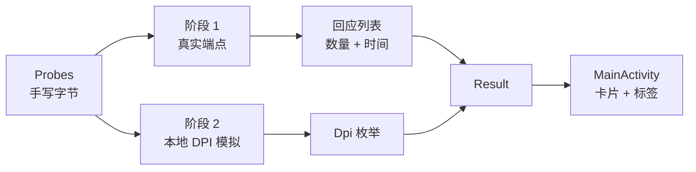

# CircumVolve 探针

[English](README.md) · **简体中文** · [繁體中文](README.zh-TW.md)

一个可在无 root 的 Android 设备上运行的**直连探测**工具，用来复现
《CircumVolve: Automated Discovery of Censorship Evasion Strategies Using
Large Language Models》（CCS 2026）在 DNS 与 TLS 两章发现的规避策略。

无代理、无 VPN、无 root：每个封包都由 app 自己构造，直接从进程发出。
界面为暗色，支持英文、简体中文和繁体中文。

- 论文：<https://gfw.report/publications/ccs26/en/>
- 原始系统代码：<https://github.com/alizohaib/ccs26-circumvolve>
- 论文中文页面：<https://gfw.report/publications/ccs26/zh/>

> 这是研究用的测量工具，用来复现已发表的结果。它不建立通道，也不是规避客户端。

## 结论：两者都能绕，但范围很窄

实测环境：中国电信 Wi-Fi、无代理、无 VPN、无 root、系统 DNS 未改。

| 封锁 | 无代理能绕过吗 | 证据 |
|---|---|---|
| DNS 污染 | **能，以单次查询为单位** | 诱饵第二问：三次独立执行都是 0/3 次被注入，每次都拿到真实解析（`+120ms`、真实 IP） |
| SNI 封锁 | **能，以单条连接为单位** | 尾点 FQDN：基线 `signal.org` 被重置、对照组 `www.cloudflare.com` 握手成功、`signal.org.` 握手成功 |

两者都是真的：对照组证明封锁存在，变体证明那一次连接绕过了它。

但范围很窄，这点必须说清楚：

- **这是封包层，不是通道。** 一次成功绕过的查询只解析一个名字一次；一次成功绕过的握手只完成一条 TCP 连接。
  两者都不等于“能连上被封的网站”。这个 app 是测量工具，不是代理的替代品。
- **DNS 绕过只对自己组查询的程序有用。** 走系统解析器的程序收到的仍是伪造回应，
  因为注入发生在通往 `:53` 的路径上，不在 app 里面。
- **每个封锁只有一个变体成功。** 七个 DNS 用例里有四个每次都吃到注入；记录拆分三种切法在这条网络上全灭，
  代表中间盒会重组 TLS 记录。
- **结果会在两次之间变动。** 同一个封包，一次收到两条伪造、一次完全干净，
  所以每个用例都送三次，报告以比率开头。

所以：**GFW 的 DNS 注入器与 SNI 比对器，在没有代理的情况下，确实可以逐封包击破；
但这不等于“能自由存取被封的网站”。** 请把结果读成“这条规则在这里被绕过了”，
而不是“封锁被破解了”。

## 为什么选这两个目标

DNS 与 TLS 被挡的层次不同，选错目标会让 TLS 那一节完全失去意义。

**DNS — `pornhub.com`。** 这里只用到名字：查询是送往 `8.8.8.8:53` 的 UDP 封包，
回应跟网站本身能不能连无关。任何在 GFW 关键字清单上的域名都行，而这个每次都会吃到伪造回应。

**TLS — `signal.org`。** 解析结果是 `104.18.10.47`／`104.18.11.47`，两个都在 Cloudflare，
地址与其他网站共用，因此一定可达。它的 SNI 在 GFW 的黑名单上：

```
IP 104.18.11.47   SNI signal.org            -> 连接重置
IP 104.18.11.47   SNI www.cloudflare.com    -> ServerHello
```

地址共用让对照组成立：同一位址、同一个端口、同样的 ClientHello 字节，只有 SNI 不同。

（较早的版本在这里用 `pornhub.com`。那个名字解析到 `66.254.114.41`，`:443` 直接拒绝，
所以每个变体——连白名单对照组——都以完全相同的方式失败，得不出任何结论。
封锁发生在被测层之下。）

所以中间盒比对的是名字，
而那正是这个 app 能尝试绕过的层。对照组每次都会执行，并以最后一张 TLS 卡片呈现；
没有它，就无法分辨“名字被封”与“地址被封”。

## 它测什么

论文对每个候选策略做两阶段评估，app 完全照搬，但在 DNS 第一阶段做了一个刻意的改动：
**数回应，而不是取第一条**。

| 阶段 | 论文 | 本 app |
|---|---|---|
| 1 有效性 | 真实解析器或服务器是否仍接受变形封包 | DNS：发出一个查询，收满 1200ms 窗口内**所有**回应；**收到多于一条就代表路径上有注入器抢答**。TLS：把构造好的 ClientHello 送到 `104.16.133.229:443`，看是否回 ServerHello |
| 2 规避 | 审查方的匹配器是否还找得到被禁字符串 | 本地 DPI 模拟器。DNS：只读 offset 12 的字面匹配器（GFW 注入器模型）与跟随指针的匹配器。TLS：只读首记录与完整重组两种 |

为什么第一阶段要数回应：在被污染的路径上，注入器 10–15ms 就回答，真解析器要 170–180ms。
只取第一条等于在量注入器，而不是解析器——app 先前对每个畸形查询都报“解析器接受”，
正是这个 bug 造成的。

## 对照论文

| 论文位置 | app 中的字符串资源 |
|---|---|
| §4.2 Table 2 压缩：前向指针 | `dns_fwd_*` |
| §4.2 Table 2 压缩：指针链 | `dns_chain_*` |
| §4.2 Table 2 多问题：诱饵 | `dns_decoy_*` |
| §4.2 Table 2 多问题：伪造 QDCOUNT | `dns_fakeqd_*` |
| §4.2 Table 2 标志位：Z / TC | `dns_ztc_*` |
| §4.2 Table 2 标志位：伪造 ANCOUNT | `dns_counts_*` |
| §4.5 Table 5 记录拆分：SNI 内／握手头内／版本混用 | `tls_split_sni_*`、`tls_split_head_*`、`tls_split_ver_*` |
| §4.5 Table 5 TCP 分段：填充扩展 | `tls_pad_*` |
| §4.5 Table 5 SNI 操纵：尾点／省略 | `tls_dot_*`、`tls_nosni_*` |
| §4.3 SNI 操纵：Punycode-hex（论文用于 QUIC） | `tls_puny_*` |

## 架构



| 文件 | 职责 |
|---|---|
| `Probes.java` | DNS/TLS 封包构造、轮询、DPI 模拟器、探测流程。只返回枚举与资源 id，不生成任何面向用户的文字 |
| `MainActivity.java` | 暗色卡片界面；所有文字都经 `R.string` |
| `res/values/strings.xml` | 英文（默认） |
| `res/values-zh-rCN/strings.xml` | 简体中文 |
| `res/values-zh-rTW/strings.xml` | 繁体中文 |
| `res/xml/locales_config.xml` | 每个 app 各自的语言选择器（Android 13+） |

这里用的 i18n 规则：

- Java 内没有任何字符串字面值。`Result` 带 `nameRes` / `noteRes`；判定结果是枚举（`Dpi`、`Server`）。
- 只用 `%1$d` / `%1$s` 位置参数，翻译时可以自由调换语序。
- 三个语系都登记在 `locales_config.xml`，所以 app 跟随系统语言，也可以在
  “设置 → 应用 → CircumVolve 探针 → 语言”单独覆写。

## 构建

```bash
export ANDROID_HOME=/opt/android-sdk JAVA_HOME=/opt/jdk21/jdk-21.0.11+10
~/.gradle/wrapper/dists/gradle-8.13-bin/*/gradle-8.13/bin/gradle :app:assembleDebug
adb install -r -t app/build/outputs/apk/debug/app-debug.apk
adb shell am start -n org.gfwreport.probe/.MainActivity
```

必须用 Gradle 8.13：AGP 8.13.1 依赖一个在 Gradle 9.6 被移除的内部 API，
系统默认的 9.8.x 会直接失败，错误信息是
`Plugin 'com.android.internal.application' relies on 'org.gradle.api.problems.internal.InternalProblems'`。

## 导出结果

运行完后，“重新运行”旁会出现“复制报告”。它把整轮结果以纯文本放进剪贴板：
app 版本、Android 版本、设备型号、被禁主机、TLS 主机、语言、各区块统计，
然后每个用例一段，含说明、DPI 判定、服务器判定，以及每一条回应与到达时间。

报告问题时要贴的就是这段文字；卡片只是同一批数据的呈现。

### 重复采样

注入器是概率性的：同一个封包，同一台设备，几分钟内可能一次收到 2 条伪造、一次收到 0 条。
所以每个 DNS 用例都送 3 次，报告以比率开头：

```
reply  1/3 次被注入
       +0ms  199.59.148.222
       +153ms  no-A
```

在 GFW 上分数结果是常态，所以摘要的 `注入 4/7` 意思是“7 个用例中，有 4 个至少一次被注入”，
不是“4 个每次都被注入”。每次都干净的那个才是重点。

- 摘要多一行 `抵达服务器 n/8 · 被拦截 m/8`：前者是收到真 TLS alert（穿过了审查，
  被服务器拒绝），后者是连接被重置或超时（在审查层就被挡）。你那次的数字是
  `抵达 2/7`（省略 server_name、Punycode-hex）——这两个变体确实穿过了 GFW 的 SNI 过滤。
  分母是 7 个变体：基线与白名单对照组是参考点，不计入任何逐变体比率。

- TLS 卡片会把“被 GFW 重置”与“服务器拒绝”分开显示：`连线被重置` 是我们送出
  ClientHello 后对端直接断线（注入或地址封锁），`被拒绝` 是真的收到 TLS alert。
  两者在旧版都印成“错误”，会把审查行为误读成协议错误。

- 按钮下方有一条确定性进度条与 `n / 16  <用例名>`，让整轮可观察：先 7 个 DNS
  用例、再 9 个 TLS 用例（含对照组），各自在自己的 socket 工作开始时计数。
  计数跨两个阶段，所以进度条不会归零重来。

## 怎么读结果

| 标签 | 意义 |
|---|---|
| 注入 | 单一查询收到多于一条回应 |
| 代理拦截 | 所有回应都来自 `198.18.0.0/15`，即本地透明代理（fake-ip）；这说明量到的不是真实路径 |
| 单一回应 | 只有一条回应，且落在 fake-ip 范围之外 |
| 无回应 | 窗口内没有任何回应 |
| 握手通过／被拒绝 | 真实服务器回了 ServerHello，或拒绝 |

`DPI BYPASS` 表示对应的模拟器没找到被禁字符串，不代表任何实际生产环境的中间盒。

## 实测

OnePlus CPH2691、Android 16、中国电信 Wi-Fi、无 VPN、无代理、无 root、系统 DNS 未改。
每次执行都是 `proxied 0/7`，所以底下每一条回应都走过真实路径。

### DNS — 三次执行，同一个 APK

| 用例 | A 次 | B 次 | C 次 |
|---|---|---|---|
| 纯 QNAME | 2 条伪造，真解没到 | 3 条（2 伪造 + 真解） | 3 条伪造 + 真解 |
| 前向压缩指针 | 伪造 + 真解 | **只有真解，干净** | 3 条，2/3 被注入 |
| 两跳指针链 | 伪造 + `no-A` | 伪造 + `no-A` | 2/3 被注入，真解 `no-A` |
| **诱饵第二问** | **只有真解** | **只有真解** | **0/3 被注入** |
| 伪造 QDCOUNT | 只有头 | 只有头 | 0/3 被注入 |
| Z + TC 位 | 2 伪造 + 真解 | 2 伪造 + 真解 | 每次都 被注入 |
| 伪造 AN/AR | 伪造 + 只有头 | 伪造 + 只有头 | 每次都 被注入 |

跨三次执行：**7 个用例里有 4 个每一次都被注入**；只有“诱饵第二问”三次都干净。

### TLS — 一次执行，地址已验证

目标 `signal.org`，地址 `104.18.11.47`。先用未改动的 `www.cloudflare.com` ClientHello 验证过该地址。

| 用例 | 送出的 SNI | 结果 |
|---|---|---|
| 基线 | `signal.org` | 连接被重置 |
| 对照组 | `www.cloudflare.com` | 握手通过 |
| **尾点** | **`signal.org.`** | **握手通过 — 绕过** |
| 省略 SNI | （无） | 被拒绝（抵达服务器，遭拒） |
| Punycode-hex | `xn--…` | 被拒绝（抵达服务器，遭拒） |
| 切在握手头内 | `signal.org` | 连接被重置 |
| 切在 SNI 内 | `signal.org` | 连接被重置 |
| 记录版本混用 | `signal.org` | 连接被重置 |

判定：`握手 1/7 · 抵达后拒绝 2/7 · 被拦截 4/7` → **已证明绕过 SNI**。

数据说明：

- 伪造回应在 `+0ms` 到 `+45ms` 就到，真解析器要 `+120ms` 到 `+277ms`。注入器比往返还快，
  所以任何保留第一条回应的实现，存的都是伪造值。
- 伪造地址来自轮替的地址池（`31.13.x`、`69.x`、`103.200-252.x`、`104.244.x`、`108.160.x`、
  `128.242.x`、`157.240.x`、`162.125.x`、`173.252.x`、`199.59.x`、`202.160.x`、`208.101.x`），
  从未与真实答案相同。
- 尾点骗过 SNI 比对器但没有骗过服务器：`signal.org.` 对 Cloudflare 是同一个名字，
  对黑名单是不同字符串。
- 记录拆分三种切法全灭，代表这个中间盒会重组 TLS 记录——论文依赖的
  “只读首记录”缺陷在这里已经补上了。
- 无 SNI 与 Punycode-hex 清掉了审查层、抵达服务器，但 Cloudflare 拒绝它们。这算“抵达”，不算“绕过”。

## 已知限制

- TLS 仍无法自证路径是直连。经代理回来的 ServerHello 一样是 ServerHello，所以某个变体回
  `ServerHello` 只有在“对照组握手成功、基线被拒”时才算绕过。DNS 有 `代理拦截` 标签是因为
  DNS 看得出本地代理；TLS 没有等价信号，这件事由对照组负责。
- 论文 §4.3 的 QUIC 变形（保留位、CRYPTO 分片、伪帧、双 ClientHello）未实现：
  需要在 app 内建完整的 QUIC Initial 加解密栈。
- 论文 §4.6 的 TCP/IP 原语（幽灵段、重叠段、选择性 RST 过滤）未实现：
  需要 `VpnService` 加用户态 TCP 栈。
- DPI 模拟器是依照论文描述实现的近似，不等于任何特定生产中间盒。

## 桌面调试备注

若主机用 TUN 劫持流量，单个 socket 仍可直连出去：

```python
s.setsockopt(socket.SOL_SOCKET, socket.SO_MARK, 0x80000)  # SO_MARK 是 36，不是 35
```

mihomo 安装了 `ip rule 5210: fwmark 0x80000/0xff0000 lookup main`，
带这个 mark 的 socket 直接走物理路由表。请用 `socket.SO_MARK` 常量；
字面值 35 是 `SO_PRIORITY`，在这里不会有任何效果。

Android app 没有 `CAP_NET_ADMIN` 就无法设置 `SO_MARK`，所以这招只在桌面可用。

## 授权

MIT，见 [LICENSE](LICENSE)。

本项目的代码用于重现论文已发表的结果。策略名称、表格与章节编号皆沿用论文；
原始方法与作者们的评估请见论文本身。本项目没有引用原始项目的代码，
`Probes.java` 是对论文所述技术的独立实现。
