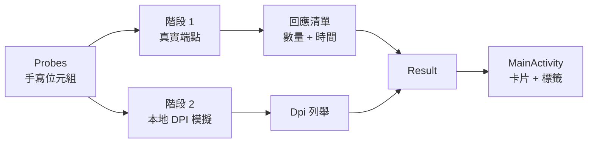

# CircumVolve 探針

一個可在無 root 的 Android 裝置上執行的**直連探測**工具，用來重現
《CircumVolve: Automated Discovery of Censorship Evasion Strategies Using
Large Language Models》（CCS 2026）在 DNS 與 TLS 兩章發現的規避策略。

無代理、無 VPN、無 root：每個封包都由 app 自己組出，直接從行程送出。
介面為暗色，支援英文、簡體中文、繁體中文。

- 論文：<https://gfw.report/publications/ccs26/en/>
- 原始系統程式碼：<https://github.com/alizohaib/ccs26-circumvolve>
- 論文中文頁面：<https://gfw.report/publications/ccs26/zh/>

> 這是研究用的量測工具，用來重現已發表的結果。它不建立通道，也不是規避客戶端。

## 結論：兩者都能繞，但範圍很窄

實測環境：中國電信 Wi-Fi、無代理、無 VPN、無 root、系統 DNS 未改。

| 封鎖 | 無代理能繞過嗎 | 證據 |
|---|---|---|
| DNS 污染 | **能，以單次查詢為單位** | 誘餌第二問：三次獨立執行都是 0/3 次被注入，每次都拿到真實解析（`+120ms`、真實 IP） |
| SNI 封鎖 | **能，以單條連線為單位** | 尾點 FQDN：基線 `signal.org` 被重置、對照組 `www.cloudflare.com` 握手成功、`signal.org.` 握手成功 |

兩者都是真的：對照組證明封鎖存在，變體證明那一次連線繞過了它。

但範圍很窄，這點必須說清楚：

- **這是封包層，不是通道。** 一次成功繞過的查詢只解析一個名字一次；一次成功繞過的握手只完成一條 TCP 連線。
  兩者都不等於「能連上被封的網站」。這個 app 是量測工具，不是代理的替代品。
- **DNS 繞過只對自己組查詢的程式有用。** 走系統解析器的程式收到的仍是偽造回應，
  因為注入發生在通往 `:53` 的路徑上，不在 app 裡面。
- **每個封鎖只有一個變體成功。** 七個 DNS 用例裡有四個每次都吃到注入；記錄拆分三種切法在這條網路上全滅，
  代表中間盒會重組 TLS 記錄。
- **結果會在兩次之間變動。** 同一個封包，一次收到兩條偽造、一次完全乾淨，
  所以每個用例都送三次，報告以比率開頭。

所以：**GFW 的 DNS 注入器與 SNI 比對器，在沒有代理的情況下，確實可以逐封包擊破；
但這不等於「能自由存取被封鎖的網站」。** 請把結果讀成「這條規則在這裡被繞過了」，
而不是「封鎖被破解了」。

## 為什麼選這兩個目標

DNS 與 TLS 被擋的層次不同，選錯目標會讓 TLS 那一節完全失去意義。

**DNS — `pornhub.com`。** 這裡只用到名字：查詢是送往 `8.8.8.8:53` 的 UDP 封包，
回應跟網站本身能不能連無關。任何在 GFW 關鍵字清單上的網域都行，而這個每次都會吃到偽造回應。

**TLS — `signal.org`。** 解析結果是 `104.18.10.47`／`104.18.11.47`，兩個都在 Cloudflare，
位址與其他網站共用，因此一定可達。它的 SNI 在 GFW 的黑名單上：

```
IP 104.18.11.47   SNI signal.org            -> 連線重置
IP 104.18.11.47   SNI www.cloudflare.com    -> ServerHello
```

位址共用讓對照組成立：同一位址、同一個埠、同樣的 ClientHello 位元組，只有 SNI 不同。

（較早的版本在這裡用 `pornhub.com`。那個名字解析到 `66.254.114.41`，`:443` 直接拒絕，
所以每個變體——連白名單對照組——都以完全相同的方式失敗，得不出任何結論。
封鎖發生在被測層之下。）

所以中間盒比對的是名字，
而那正是這個 app 能嘗試繞過的層。對照組每次都會執行，並以最後一張 TLS 卡片呈現；
沒有它，就無法分辨「名字被封」與「位址被封」。

## 它測什麼

論文對每個候選策略做兩階段評估，app 完全照搬，但在 DNS 第一階段做了一個刻意的改動：
**數回應，而不是取第一條**。

| 階段 | 論文 | 本 app |
|---|---|---|
| 1 有效性 | 真實解析器或伺服器是否仍接受變形封包 | DNS：送出一個查詢，收滿 1200ms 視窗內**所有**回應；**收到多於一條就代表路徑上有注入器搶答**。TLS：把構造好的 ClientHello 送到 `104.16.133.229:443`，看是否回 ServerHello |
| 2 規避 | 審查方的比對器是否還找得到被禁字串 | 本地 DPI 模擬器。DNS：只讀 offset 12 的字面比對器（GFW 注入器模型）與跟隨指標的比對器。TLS：只讀首記錄與完整重組兩種 |

為什麼第一階段要數回應：在被污染的路径上，注入器 10–15ms 就回答，真解析器要 170–180ms。
只取第一條等於在量注入器，而不是解析器——app 先前對每個畸形查詢都報「解析器接受」，
正是這個 bug 造成的。

## 對照論文

| 論文位置 | app 中的字串資源 |
|---|---|
| §4.2 Table 2 壓縮：前向指標 | `dns_fwd_*` |
| §4.2 Table 2 壓縮：指標鏈 | `dns_chain_*` |
| §4.2 Table 2 多問題：誘餌 | `dns_decoy_*` |
| §4.2 Table 2 多問題：偽造 QDCOUNT | `dns_fakeqd_*` |
| §4.2 Table 2 標誌位：Z / TC | `dns_ztc_*` |
| §4.2 Table 2 標誌位：偽造 ANCOUNT | `dns_counts_*` |
| §4.5 Table 5 記錄拆分：SNI 內／握手標頭內／版本混用 | `tls_split_sni_*`、`tls_split_head_*`、`tls_split_ver_*` |
| §4.5 Table 5 TCP 分段：填充擴充 | `tls_pad_*` |
| §4.5 Table 5 SNI 操縱：尾點／省略 | `tls_dot_*`、`tls_nosni_*` |
| §4.3 SNI 操縱：Punycode-hex（論文用於 QUIC） | `tls_puny_*` |

## 架構



| 檔案 | 職責 |
|---|---|
| `Probes.java` | DNS/TLS 封包構造、輪詢、DPI 模擬器、探測流程。只回傳列舉與資源 id，不產生任何面向使用者的文字 |
| `MainActivity.java` | 暗色卡片介面；所有文字都經 `R.string` |
| `res/values/strings.xml` | 英文（預設） |
| `res/values-zh-rCN/strings.xml` | 簡體中文 |
| `res/values-zh-rTW/strings.xml` | 繁體中文 |
| `res/xml/locales_config.xml` | 每個 app 各自的語言選擇器（Android 13+） |

這裡用的 i18n 規則：

- Java 內沒有任何字串字面值。`Result` 帶 `nameRes` / `noteRes`；判定結果是列舉（`Dpi`、`Server`）。
- 只用 `%1$d` / `%1$s` 位置參數，翻譯時可以自由調換語序。
- 三個語系都登記在 `locales_config.xml`，所以 app 跟隨系統語言，也可以在
  「設定 → 應用程式 → CircumVolve 探針 → 語言」單獨覆寫。

## 建置

```bash
export ANDROID_HOME=/opt/android-sdk JAVA_HOME=/opt/jdk21/jdk-21.0.11+10
~/.gradle/wrapper/dists/gradle-8.13-bin/*/gradle-8.13/bin/gradle :app:assembleDebug
adb install -r -t app/build/outputs/apk/debug/app-debug.apk
adb shell am start -n org.gfwreport.probe/.MainActivity
```

必須用 Gradle 8.13：AGP 8.13.1 依賴一個在 Gradle 9.6 被移除的內部 API，
系統預設的 9.8.x 會直接失敗，錯誤訊息是
`Plugin 'com.android.internal.application' relies on 'org.gradle.api.problems.internal.InternalProblems'`。

## 匯出結果

執行完後，「重新執行」旁會出現「複製報告」。它把整輪結果以純文字放進剪貼簿：
app 版本、Android 版本、裝置型號、被禁主機、TLS 主機、語系、各區塊統計，
然後每個用例一段，含說明、DPI 判定、伺服器判定，以及每一條回應與到達時間。

回報問題時要貼的就是這段文字；卡片只是同一批資料的呈現。

### 重複採樣

注入器是機率性的：同一個封包，同一台裝置，幾分鐘內可能一次收到 2 條偽造、一次收到 0 條。
所以每個 DNS 用例都送 3 次，報告以比率開頭：

```
reply  1/3 次被注入
       +0ms  199.59.148.222
       +153ms  no-A
```

在 GFW 上分數結果是常態，所以摘要的 `注入 4/7` 意思是「7 個用例中，有 4 個至少一次被注入」，
不是「4 個每次都被注入」。每次都乾淨的那個才是重點。

- 摘要多一行 `抵達伺服器 n/8 · 被攔截 m/8`：前者是收到真 TLS alert（穿過了審查，
  被伺服器拒絕），後者是連線被重置或逾時（在審查層就被擋）。你那次的數字是
  `抵達 2/7`（省略 server_name、Punycode-hex）——這兩個變體確實穿過了 GFW 的 SNI 過濾。
  分母是 7 個變體：基線與白名單對照組是參考點，不計入任何逐變體比率。

- TLS 卡片會把「被 GFW 重置」與「伺服器拒絕」分開顯示：`連線被重置` 是我們送出
  ClientHello 後對端直接斷線（注入或位址封鎖），`被拒絕` 是真的收到 TLS alert。
  兩者在舊版都印成「錯誤」，會把審查行為誤讀成協定錯誤。

- 按鈕下方有一條確定性進度條與 `n / 16  <用例名>`，讓整輪可觀察：先 7 個 DNS
  用例、再 9 個 TLS 用例（含對照組），各自在自己的 socket 工作開始時計數。
  計數跨兩個階段，所以進度條不會歸零重來。

## 怎麼讀結果

| 標籤 | 意義 |
|---|---|
| 注入 | 單一查詢收到多於一條回應 |
| 代理攔截 | 所有回應都來自 `198.18.0.0/15`，即本地透明代理（fake-ip）；這代表量到的不是真實路徑 |
| 單一回應 | 只有一條回應，且落在 fake-ip 範圍之外 |
| 無回應 | 視窗內沒有任何回應 |
| 握手通過／被拒絕 | 真實伺服器回了 ServerHello，或拒絕 |

`DPI BYPASS` 表示對應的模擬器沒找到被禁字串，不代表任何實際生產環境的中間盒。

## 實測

OnePlus CPH2691、Android 16、中國電信 Wi-Fi、無 VPN、無代理、無 root、系統 DNS 未改。
每次執行都是 `proxied 0/7`，所以底下每一條回應都走過真實路徑。

### DNS — 三次執行，同一個 APK

| 用例 | A 次 | B 次 | C 次 |
|---|---|---|---|
| 純 QNAME | 2 條偽造，真解沒到 | 3 條（2 偽造 + 真解） | 3 條偽造 + 真解 |
| 前向壓縮指標 | 偽造 + 真解 | **只有真解，乾淨** | 3 條，2/3 被注入 |
| 兩跳指標鏈 | 偽造 + `no-A` | 偽造 + `no-A` | 2/3 被注入，真解 `no-A` |
| **誘餌第二問** | **只有真解** | **只有真解** | **0/3 被注入** |
| 偽造 QDCOUNT | 只有標頭 | 只有標頭 | 0/3 被注入 |
| Z + TC 位 | 2 偽造 + 真解 | 2 偽造 + 真解 | 每次都 被注入 |
| 偽造 AN/AR | 偽造 + 只有標頭 | 偽造 + 只有標頭 | 每次都 被注入 |

跨三次執行：**7 個用例裡有 4 個每一次都被注入**；只有「誘餌第二問」三次都乾淨。

### TLS — 一次執行，位址已驗證

目標 `signal.org`，位址 `104.18.11.47`。先用未改動的 `www.cloudflare.com` ClientHello 驗證過該位址。

| 用例 | 送出的 SNI | 結果 |
|---|---|---|
| 基線 | `signal.org` | 連線被重置 |
| 對照組 | `www.cloudflare.com` | 握手通過 |
| **尾點** | **`signal.org.`** | **握手通過 — 繞過** |
| 省略 SNI | （無） | 被拒絕（抵達伺服器，遭拒） |
| Punycode-hex | `xn--…` | 被拒絕（抵達伺服器，遭拒） |
| 切在握手標頭內 | `signal.org` | 連線被重置 |
| 切在 SNI 內 | `signal.org` | 連線被重置 |
| 記錄版本混用 | `signal.org` | 連線被重置 |

判定：`握手 1/7 · 抵達後拒絕 2/7 · 被攔截 4/7` → **已證明繞過 SNI**。

數據說明：

- 偽造回應在 `+0ms` 到 `+45ms` 就到，真解析器要 `+120ms` 到 `+277ms`。注入器比往返還快，
  所以任何保留第一條回應的實作，存的都是偽造值。
- 偽造位址來自輪替的位址池（`31.13.x`、`69.x`、`103.200-252.x`、`104.244.x`、`108.160.x`、
  `128.242.x`、`157.240.x`、`162.125.x`、`173.252.x`、`199.59.x`、`202.160.x`、`208.101.x`），
  從未與真實答案相同。
- 尾點騙過 SNI 比對器但沒有騙過伺服器：`signal.org.` 對 Cloudflare 是同一個名字，
  對黑名單是不同字串。
- 記錄拆分三種切法全滅，代表這個中間盒會重組 TLS 記錄——論文依賴的
  「只讀首記錄」缺陷在這裡已經補上了。
- 無 SNI 與 Punycode-hex 清掉了審查層、抵達伺服器，但 Cloudflare 拒絕它們。這算「抵達」，不算「繞過」。

## 已知限制

- TLS 仍無法自證路徑是直連。經代理回來的 ServerHello 一樣是 ServerHello，所以某個變體回
  `ServerHello` 只有在「對照組握手成功、基線被拒」時才算繞過。DNS 有 `代理攔截` 標籤是因為
  DNS 看得出本地代理；TLS 沒有等價訊號，這件事由對照組負責。
- 論文 §4.3 的 QUIC 變形（保留位、CRYPTO 分片、偽幀、雙 ClientHello）未實作：
  需要在 app 內建完整的 QUIC Initial 加解密堆疊。
- 論文 §4.6 的 TCP/IP 原語（幽靈段、重疊段、選擇性 RST 過濾）未實作：
  需要 `VpnService` 加使用者空間 TCP 堆疊。
- DPI 模擬器是依照論文描述實作的近似，不等於任何特定生產中間盒。

## 桌面除錯備註

若主機用 TUN 劫持流量，單一 socket 仍可直連出去：

```python
s.setsockopt(socket.SOL_SOCKET, socket.SO_MARK, 0x80000)  # SO_MARK 是 36，不是 35
```

mihomo 安裝了 `ip rule 5210: fwmark 0x80000/0xff0000 lookup main`，
帶這個 mark 的 socket 直接走實體路由表。請用 `socket.SO_MARK` 常數；
字面值 35 是 `SO_PRIORITY`，在這裡不會有任何效果。

Android app 沒有 `CAP_NET_ADMIN` 就無法設定 `SO_MARK`，所以這招只在桌面可用。

## 授權與出處

本專案的程式碼用於重現已發表的結果。策略名稱、表格與章節編號皆沿用論文；
原始方法與作者們的評估請見論文本身。
